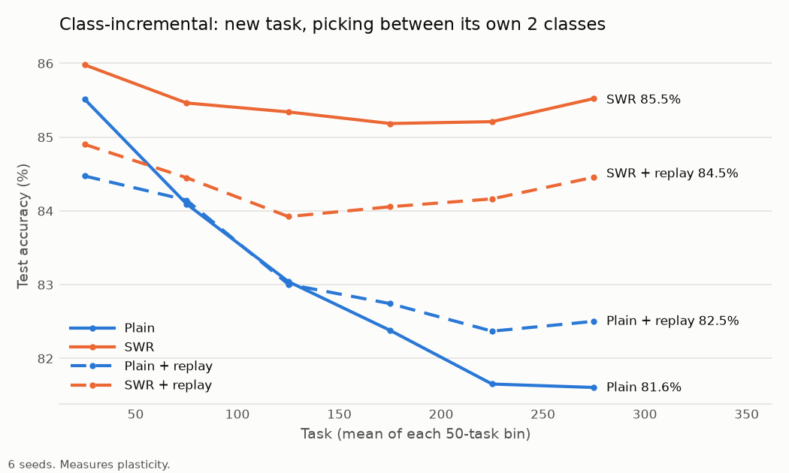
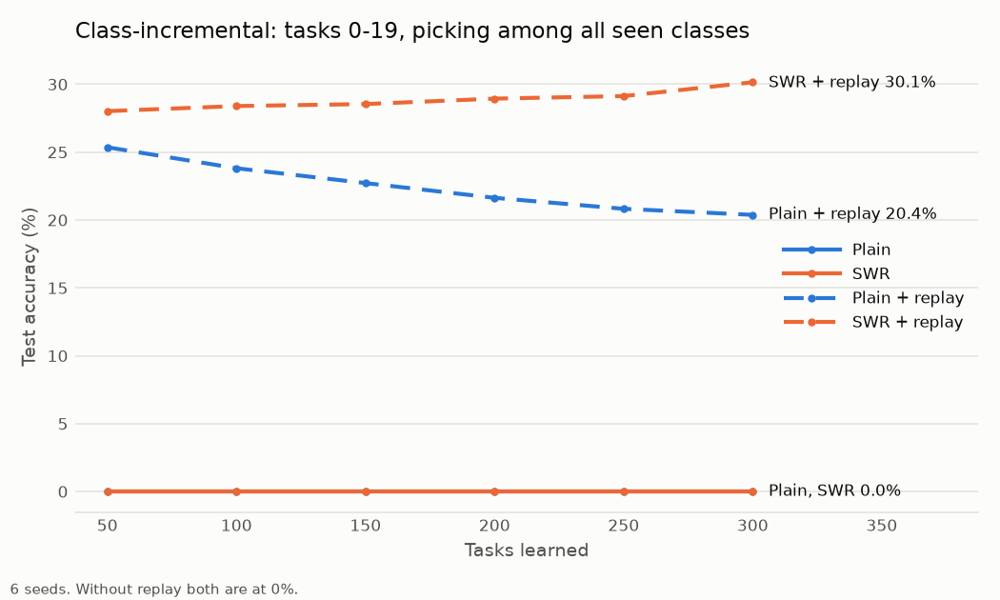
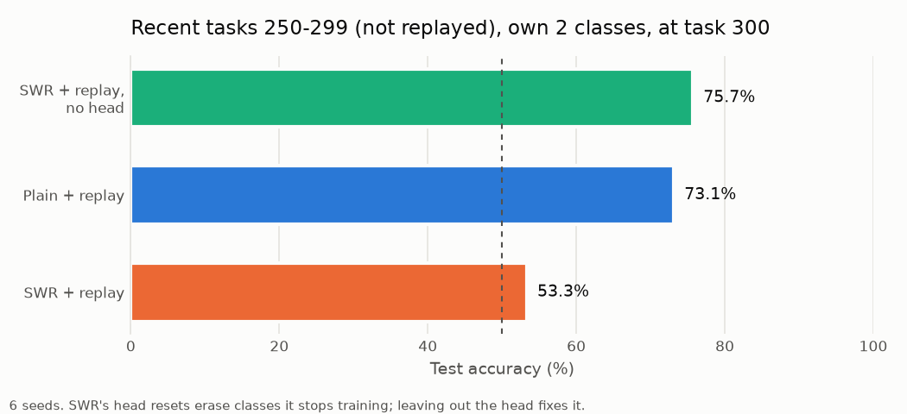
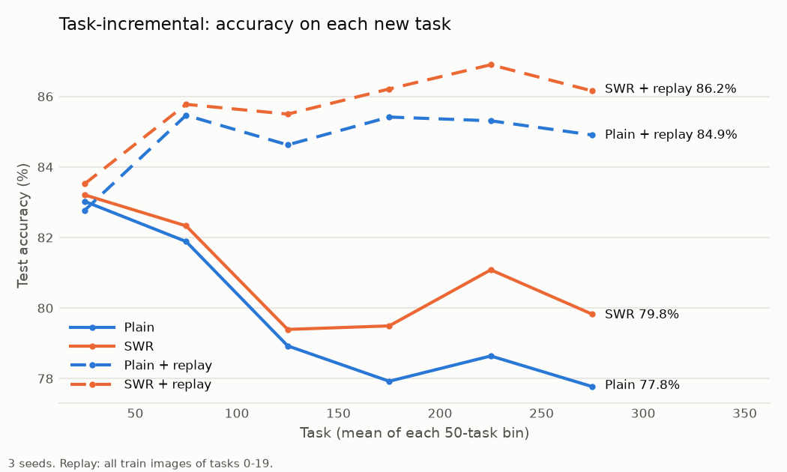

# swr and replay in class-incremental learning

continual learning isn't about remembering everything. humans forget too. it's about being able to learn whatever's new, and holding on to what you replay. that's sutton's big world thing: the world's bigger than the model, so it can't keep everything anyway.

## the setup

took dohare/sutton's continual imagenet. small cnn, 177k params. 300 tasks in a row, each task is 2 new imagenet classes at 32x32.

their version resets the head at every task and only tests the current task, so it only measures plasticity: can the net still learn new stuff. nothing about memory.

i made it class-incremental. one head for every class. at test time the model picks among every class it's seen, no hint which task the image came from. that's the real test. task-incremental is the easy version: the model only has to pick between the 2 classes of the task it's told it's on.

arms:
- plain backprop
- swr (sutton's lab, 2025): resets weights whose utility `|w * grad|` is tiny
- replay: keeps all images of tasks 0-19 and mixes 50 into every batch
- swr and replay

6 seeds each.

## what happened

**swr keeps plasticity.** on new tasks 250-299, plain drops to 81.6%, swr stays at 85.5%. swr won on all 6 seeds.

**no replay = no memory.** tasks 0-19 sit at 0% by task 300. the model only ever predicts the newest classes.

**swr and replay remembers best.** tasks 0-19 among all 600 classes at task 300: swr and replay 30.1% and still going up, plain and replay 20.4% and dropping. chance is about 0.2%. swr and replay won on all 6 seeds.

**the catch: swr was quietly erasing stuff.** i tested recent tasks (250-299, not replayed) on just their own 2 classes at the end. plain and replay still tells them apart at 73%. swr and replay: 53%, basically a coin flip. checked the head: in swr, the rows for classes it stopped training sit at exactly fresh-init size (0.578, init is 0.577). in swr and replay the recent ones are at 0.633, almost back to init. in plain they stay at 1.0-1.3. swr was resetting them, because a class you stop training has near-zero gradient, so near-zero utility.

**fix: don't run swr on the head.** swr and replay without the head:
- plasticity same, 84.5%
- tasks 0-19 same, 29.5%
- recent pairs back to 75.7%

so the plasticity comes from swr on the body. the head resets were just deleting memory.

**still unsolved: old-class bias.** replay arms label a lot of new images as the replayed classes. replayed head rows end up 3.4-4.3x bigger. rescaling them to the same size (weight aligning) made it worse, so the bias isn't just in the head.

## controls

**is replay just more data?** replay adds 50 images to every batch. so i gave the no-replay arms 50 extra images per batch too, just from the current task instead of old ones.
- plain: no change, 81.6% either way
- swr: 85.5% -> 87.0%

so the fair comparison for swr and replay (84.5%) is swr with extra images (87.0%). replay is 2.5 points worse at learning new tasks, and in exchange keeps 30% of tasks 0-19 instead of 0%.

**replay in the original setup (task-incremental, own head per task, 3 seeds):** replaying tasks 0-19 also kept plain backprop learning new tasks, not just remembering old ones. new tasks 250-299, plain backprop:
- no replay: 77.8%
- 50 extra current-task images per batch: 79.5%
- replay of tasks 0-19: 84.9%

so it's the old tasks that help, not just more images. dead units (neurons that never fire) at task 300: 3-4% without replay, even with extra images. about 0% with replay.

## what i think it means

plasticity methods only ask "is this weight useful right now". they never ask "is this worth keeping". so they'll erase anything you're not actively training. memory has to come from replay, and resets have to stay out of what replay is protecting.

i don't buy adapters or harness hill-climbing as continual learning. the fix has to be in the network's own machinery: how it updates, what it resets, what it replays.

## next

- the model picks what to replay itself. during sleep you replay stuff; the model should have something built in that's drawn to replaying what it thinks matters, instead of a fixed set
- second dataset
- one other reset method (continual backprop or shrink & perturb) to show the erasing isn't just swr

code, logs and how to rerun everything: [github.com/JayZenith/CL](https://github.com/JayZenith/CL)
