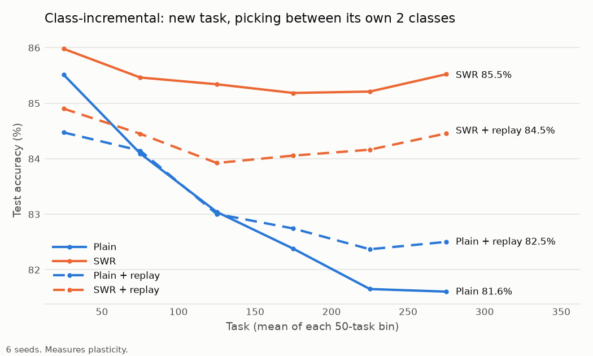
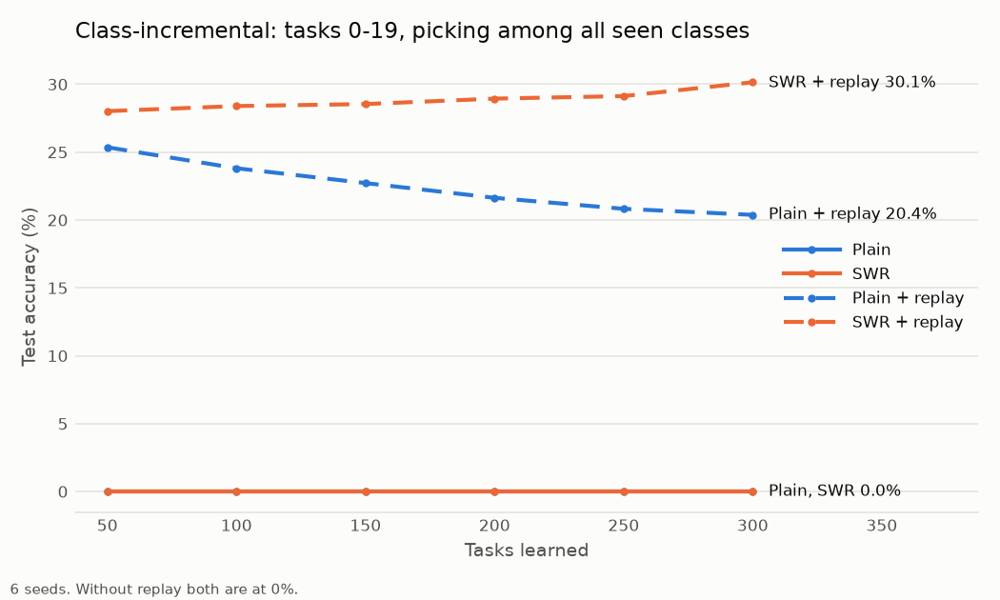
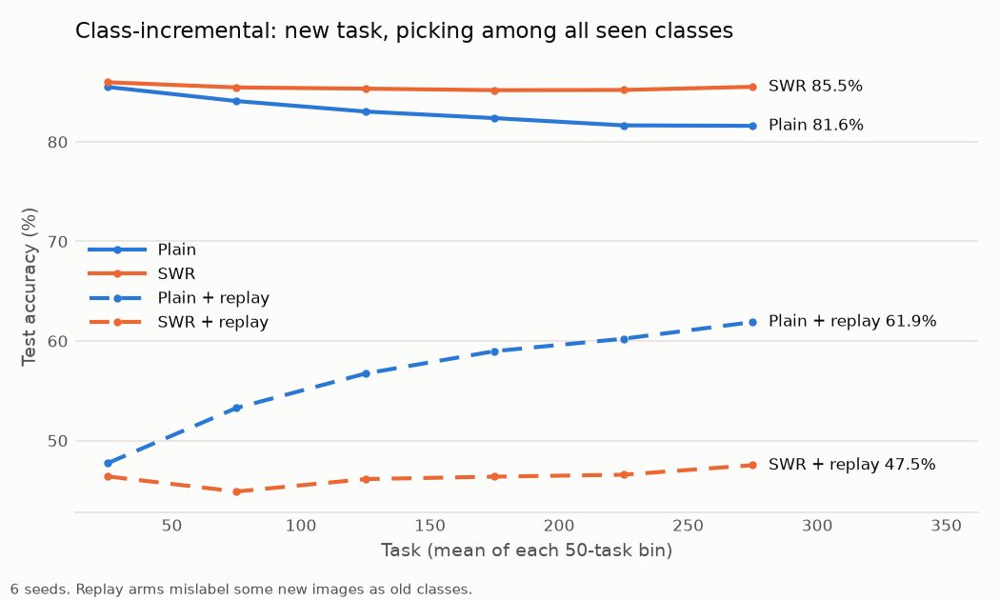
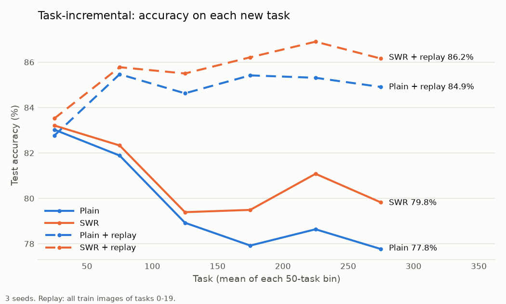

# Continual ImageNet: plasticity and memory with SWR and replay

Builds on [Dohare et al. 2024](https://arxiv.org/abs/2306.13812) (data and class order from [their code](https://github.com/shibhansh/loss-of-plasticity)) and adds SWR from [Hernandez-Garcia et al. 2025](https://arxiv.org/abs/2508.00212).

A small CNN (177K params) learns 300 tasks in a row. Each task is a new pair of ImageNet classes at 32×32: 1,200 train and 200 test images, 250 epochs, batch 100, SGD with momentum 0.9, lr 0.001.

- **Plasticity**: accuracy on each new task, right after learning it. If it falls over time, the network is losing plasticity.
- **Memory**: accuracy on old tasks later on.

Two setups:

- **Task-incremental** (`train.py`, as in Dohare): a 2-output head, reset at each task. Each test picks between one task's 2 classes.
- **Class-incremental** (`cil.py`): one shared head for all classes. Task t adds classes 2t and 2t+1. Each test picks among every class seen so far, with no hint which task an image is from.

Arms:

- **Plain**: backprop.
- **SWR**:
  - Every 2,048 steps, each weight and bias with utility |w · ∂L/∂w| ≤ k × the mean utility of its tensor is redrawn from its init distribution.
  - k = 0.01, the best of 1e-5 to 1e-2 in a 100-task sweep.
- **Replay**: keeps all train images of tasks 0–19 and adds 50 of them to every step.
  - Task-incremental: each replayed image is scored by its own task's saved, frozen 2-way head.
  - Class-incremental: replayed images keep their own labels in the shared head.

Every experiment:

| Experiment | Setup | Seeds | Logs |
|---|---|---|---|
| Plain vs SWR vs SWR + small replay | Task-incremental | 6 | `lop_swr/` |
| Replay all of tasks 0–19 | Task-incremental | 3 | `lop_rp600/` |
| Extra-images control | Task-incremental | 3 | `lop_x50/` |
| Plain vs SWR, with and without replay of tasks 0–19 | **Class-incremental** | 6 | `lop_cil/` |
| Extra-images control | **Class-incremental** | 6 | `lop_cil_x50/` |
| SWR without the head, with and without replay | **Class-incremental** | 6 | `lop_cil_nohead/` |

Only the `lop_cil*/` folders are class-incremental. Everything else is task-incremental.

## Class-incremental results

6 seeds, `results/lop_cil/` and `results/lop_cil_x50/`. "Extra images" adds 50 current-task images per step, as many as replay adds, with no replay.

| | Plain | Plain + extra images | Plain + replay | SWR | SWR + extra images | SWR + replay |
|---|---|---|---|---|---|---|
| New task, own 2 classes, tasks 0–49 | 85.5% | 86.0% | 84.5% | 86.0% | 87.1% | 84.9% |
| New task, own 2 classes, tasks 250–299 | 81.6% | 81.6% | 82.5% | 85.5% | 87.0% | 84.5% |
| New task, all seen classes, tasks 250–299 | 81.6% | 81.6% | 61.9% | 85.5% | 87.0% | 47.5% |
| Tasks 0–19 among all seen, at task 50 | 0% | 0% | 25.4% | 0% | 0% | 28.0% |
| Tasks 0–19 among all seen, at task 300 | 0% | 0% | 20.4% | 0% | 0% | 30.1% |
| Tasks 0–19 among only their 40 classes, at task 300 | 2.6% | 2.7% | 27.7% | 2.3% | 2.8% | 32.3% |
| All 600 classes, at task 300 | 0.3% | 0.3% | 1.6% | 0.3% | 0.3% | 2.2% |
| Tasks 0–19, own 2 classes, at task 300 | 51.9% | 49.2% | 79.3% | 49.6% | 49.9% | 82.7% |
| Tasks 250–299, own 2 classes, at task 300 | 53.1% | 52.2% | 73.1% | 50.7% | 50.4% | 53.3% |

The last two rows come from `pair.py` (`lop_cil/pair.csv`, which covers both folders). The 2-class rows have 50% chance. At task 300, the all-seen rows have about 0.2% chance.

- **Plasticity:** SWR keeps it. Plain loses about 4 points. SWR was ahead on all 6 seeds.
- **Extra images:** no change for plain, +1.5 points for SWR. Against this control, replay costs SWR 2.5 points of plasticity and buys its memory of tasks 0–19.
- **Memory without replay:** none. The model only predicts the newest classes, which is why its two "new task" rows are equal.
- **Memory with replay:**
  - SWR + replay holds tasks 0–19 better over time, rising, while plain + replay decays. SWR + replay was ahead on all 6 seeds.
  - For SWR + replay, most errors are confusions among those 40 classes (32.3% vs 30.1%). Plain + replay loses more to newer classes (27.7% vs 20.4%).
- **Cost of replay:** new images get labeled as replayed classes. SWR + replay does this most (47.5%).
- **Classes not replayed:** forgotten within a few tasks in every arm. At task 300, tasks 250–299 are under 2% among all seen classes (0.7–1.9%).
  - Plain + replay is the exception on the 2-class test: it still tells tasks 250–299's pairs apart at 73.1%, against about 50–53% in every other arm, SWR + replay included. Cause, from head row norms at task 300: SWR resets the head rows of classes it no longer trains, whose utility falls toward zero.
    - In SWR, the rows of untrained classes have norm 0.578. A freshly initialized row has 0.577.
    - In SWR + replay, tasks 250–297's rows are at 0.633.
    - In plain arms they stay at 1.0–1.3.
- **Head bias (`wa.py`, `wa.csv`):**
  - Replayed classes end up with head rows 3.4–4.3× larger than other classes.
  - Scaling every row to the mean norm, a simple form of weight aligning ([Zhao et al. 2020](https://arxiv.org/abs/1911.07053)), makes things worse. SWR + replay drops from 30.1% to 15.7% on tasks 0–19, and from 2.2% to 1.4% on all classes.
  - So the bias is not only in the head's scale.

### SWR without the head

`--swr-no-head`, 6 seeds, `results/lop_cil_nohead/`. Measured at task 300 unless a range is given.

| | SWR | SWR, no head | SWR + replay | SWR + replay, no head | Plain + replay |
|---|---|---|---|---|---|
| New task, own 2 classes, tasks 250–299 | 85.5% | 85.7% | 84.5% | 84.5% | 82.5% |
| New task, all seen classes, tasks 250–299 | 85.5% | 85.7% | 47.5% | 46.7% | 61.9% |
| Tasks 0–19 among all seen | 0% | 0% | 30.1% | 29.5% | 20.4% |
| Tasks 0–19, own 2 classes | 49.6% | 50.4% | 82.7% | 83.7% | 79.3% |
| Tasks 250–299, own 2 classes | 50.7% | 51.0% | 53.3% | **75.7%** | 73.1% |

- Plasticity comes from SWR on the body. Leaving out the head changes nothing there.
- With replay, leaving out the head keeps recent tasks' pairs apart: 75.7% vs 53.3%, slightly above plain + replay.
  - Its recent-class head rows stay at norm 1.07 instead of being reset to about 0.58.
  - Memory of tasks 0–19 is unchanged.
- It is the best arm on every 2-class test. Among all classes, the recent tasks are still lost to the replayed classes' bias.
- The replayed classes' head rows are still 3.6× larger, and weight aligning still hurts (`wa.csv`).





## Task-incremental results

### Plain vs SWR (task-incremental)

6 seeds, `results/lop_swr/`. "SWR + replay" here keeps 10 images per class of every task learned so far.

| Tasks | Plain | SWR | SWR + replay |
|---|---|---|---|
| 0–49 | 83.3% | 83.6% | 82.3% |
| 250–299 | 78.3% | 81.0% | 80.6% |

SWR dropped less than plain on all 6 seeds.

At task 300, relearning old tasks (250–269) vs learning new ones (300–319), median epochs to 95% train accuracy (250 if never reached):

| | Plain | SWR | SWR + replay |
|---|---|---|---|
| Relearn old | 44.5 | 12 | 11 |
| Learn new | 50 | 12 | 13 |
| Old-task test accuracy, saved head | 58.9% | 50.4% | 72.8% |

- SWR learns about 4× faster than plain. Old and new tasks take it equally long, so it remembers nothing (50% is chance).
- SWR + replay keeps SWR's speed and remembers the most. It relearns old tasks faster than it learns new ones on 5 of 6 seeds.

### Replaying all of tasks 0–19 (task-incremental)

3 seeds, `results/lop_rp600/`.

| | Plain | SWR | Plain + replay | SWR + replay |
|---|---|---|---|---|
| New tasks 0–49 | 83.0% | 83.2% | 82.8% | 83.5% |
| New tasks 250–299 | 77.8% | 79.8% | 84.9% | 86.2% |
| Tasks 0–19 when learned | 85.6% | 85.4% | 82.9% | 83.6% |
| Tasks 0–19 at task 300, saved head | 50.0% | 50.6% | 84.5% | 85.0% |
| Epochs, tasks 0–19 first time | 60.5 | 54.5 | 49.5 | 45 |
| Epochs, relearn tasks 0–19 | 31 | 12 | 2 | 2 |
| Epochs, new tasks 300–319 | 32.5 | 12 | 9 | 14 |

- Without replay, tasks 0–19 are at chance by task 300. With replay, they stay at the accuracy they were learned with.
- Replay also stopped plasticity loss, even for plain.
- **Extra-images control** (`results/lop_x50/`, 3 seeds): 50 more current-task images per step, as many as replay adds.
  - New tasks 250–299: 79.5% for plain and 81.3% for SWR.
  - So most of replay's gain is not extra data. Whether it comes from revisiting the same tasks or from the variety of classes per step was not tested.
- **Units at task 300** (`units.csv`, measured on images of the next 10 unseen tasks):

  | | Plain | Plain + extra images | SWR | Plain + replay | SWR + replay |
  |---|---|---|---|---|---|
  | Dead units | 3–4% | 3–4% | 0% | 0–0.2% | 0% |
  | Mean \|weight\| | 0.055 | | 0.042 | 0.069 | 0.054 |

  - Replay keeps units alive, like SWR does, but its weights grow.
  - Effective rank of the last hidden layer did not track accuracy. SWR + replay had the lowest (66) and was the most accurate.



## Caveats

- **k was picked on the test set.** There is no validation split. SWR's k was the best of 1e-5 to 1e-2 by test accuracy (100 tasks, seeds 0–1), and those seeds are reused in the final runs. The sweep logs were not kept.
  - Example: 4 values of k score 80.1%, 80.5%, 81.0% and 80.3% on the test set, and we keep the 81.0% one. Its real skill might be 80.5%, plus 0.5 points of luck on those exact images. Reporting 81.0% then overstates it a little. Picked on separate images, that luck wouldn't carry over to the test score.
  - Clean fix: pick k on images or seeds that are never used for the reported results.
  - Here it's minor: seeds 2–5 were never used to pick k, and SWR still beat plain on them.
- **The no-head runs come from a different script.** `cil_multi.py` made them; `cil.py` made the other class-incremental runs. The training rules are the same (`test_multi.py` checks this), but each script turns the seed into random numbers differently.
  - Example: with seed 0, `cil.py` might put images 5, 812, 40… in the first batch, and `cil_multi.py` images 377, 9, 1103…. Same rules, different dice rolls.
  - Effect: "SWR + replay" vs "SWR + replay, no head" also differs by normal seed-to-seed noise, not just by the head. That's noise, not bias, and it averages out over 6 seeds. Both scripts are seeded and their results point the same way, so this is minor, just less tightly controlled than running every arm through one script.
- **One small CNN on one dataset.** The findings may not hold for bigger models or other data.

## Reproduce

`./setup.sh` builds `.venv` and downloads the data (9 GB zip, 17 GB unpacked) and class order into `data/`.

Timings are on 2× RTX 3060. `run.sh` runs each arm for seeds 0 to n-1, split across both GPUs. It first clears leftover workers, and rerunning it resumes from the last 50-task checkpoint.

```bash
# Plain vs SWR vs SWR + replay (6 seeds, about 2.6 h per pair of arms)
tmux new -d -s lop ./run.sh 6 "--swr-k 0;--swr-k 1e-2" --lr 0.001 --tasks 300
tmux new -d -s rp ./run.sh 6 "--swr-k 1e-2 --replay-per-class 10" --lr 0.001 --tasks 300
./savings.sh

# Replay all of tasks 0-19 (3 seeds, about 3 h); sav0.sh then runs savings.py --old 0 20 on each run
tmux new -d -s rp600 ./run.sh 3 "--swr-k 0;--swr-k 1e-2;--swr-k 0 --replay-per-class 600 --replay-tasks 20;--swr-k 1e-2 --replay-per-class 600 --replay-tasks 20" --lr 0.001 --tasks 300
tmux new -d -s x50 ./run.sh 3 "--swr-k 0 --extra-batch 50;--swr-k 1e-2 --extra-batch 50" --lr 0.001 --tasks 300
.venv/bin/python units.py runs/*/ > units.csv

# Class-incremental (6 seeds)
tmux new -d -s cil 'SCRIPT=cil.py ./run.sh 6 "--swr-k 0;--swr-k 1e-2;--swr-k 0 --replay-tasks 20;--swr-k 1e-2 --replay-tasks 20"'
.venv/bin/python wa.py runs_cil/*/ > runs_cil/wa.csv
.venv/bin/python pair.py runs_cil/*/ > runs_cil/pair.csv
tmux new -d -s cilx 'SCRIPT=cil.py ./run.sh 6 "--swr-k 0 --extra-batch 50;--swr-k 1e-2 --extra-batch 50"'
```

In `cil.py`, resuming needs the same `--tasks`, since that sets the head size. SWR's reinit count includes unused head rows.

Differences from Dohare's code: test accuracy is measured only after the last epoch (the only value their plots use), and seeds are fixed.

## Files

- `swr.py`: SWR, from Hernandez-Garcia et al. (`LICENSE.swr`). Dohare et al.'s data and class order are under `LICENSE.lop`.
- `setup.sh`, `requirements.txt`: environment and data.
- `train.py`: task-incremental runs. Every 50 tasks it also tests the task from 50 tasks back and writes `probe.csv`.
- `cil.py`: class-incremental runs.
- `cil_multi.py`: `cil.py` with all seeds in one process, about 2× faster on a 3060. `--swr-no-head` leaves the head out of SWR. Use `SCRIPT=cil_multi.py ./run.sh 6 "..."`, which runs one process per arm.
  - **Bottleneck:** GPU compute, not Python overhead. One seed's step took 2.5 ms and six stacked took 14.2 ms, so stacking alone gave only about 1.3×.
  - **Speed-up:** `torch.compile` fuses the step's GPU kernels, a further 1.4× (14.2 ms to 9.8 ms per step for 6 seeds). Unseen classes are masked to -inf instead of sliced off, so it compiles once instead of once per task.
  - **Benchmark:** in 7 minutes on one GPU, with SWR + replay, 6 separate `cil.py` runs finished 7 tasks and `cil_multi.py` finished 13.
  - **Same math:** the seeds' nets are stacked (grouped convs, batched matmuls). Each seed keeps its own weights, class order, batches, SGD momentum and SWR threshold, and summing the per-seed losses gives each seed exactly its own gradient. Only the random streams differ from separate runs.
  - **Check:** `test_multi.py` matches separate nets to within 1e-5 per step. SWR reset counts are within 1 in about 185,000, from float rounding at the threshold.
- `test_multi.py`: the check above.
  - `log.csv` holds each new task's accuracy: `test_acc_pair` among its own 2 classes, `test_acc_seen` among all seen classes.
  - `eval.csv`, every 50 tasks, holds:
    - `old_acc_seen`: tasks 0–19 among all seen classes.
    - `old_acc_old`: tasks 0–19 among only their 40 classes.
    - `all_acc_seen`: all classes seen so far.
- `run.sh`: launches the arms, as above. `sweep.sh` runs the SWR strength sweep.
- `savings.py`, `savings.sh`, `sav0.sh`: from a final checkpoint, relearn old tasks and learn new ones, then write `savings.csv`.
- `analyze.py`, `analyze_cil.py`: accuracy in 50-task bins.
- `units.py`: dead units, mean |weight| and effective rank.
- `wa.py`: the head-norm alignment check.
- `pair.py`: 2-class accuracy of old and recent tasks on final class-incremental checkpoints.
- `plots.py`: the figures in `results/figures/`.

## Logs

All in `results/`:

- `lop/`: first plain-only reproduction (6 seeds; 83.3% to 77.9% on new tasks).
- `lop_swr/`: plain vs SWR vs SWR + replay, with `probe.csv` and `savings.csv`.
- `lop_rp600/`: replay of all of tasks 0–19, with `savings.csv` and `units.csv`.
- `lop_x50/`: the extra-images control, with `units.csv`.
- `lop_cil/`: class-incremental, with checkpoints, `wa.csv` and `pair.csv`.
- `lop_cil_x50/`: the class-incremental extra-images control, with checkpoints.
- `lop_cil_nohead/`: SWR without the head, with checkpoints, `pair.csv` and `wa.csv`.
- `lop_rp20_small/`: replay of 10 images per class of tasks 0–19, stopped at task 134. This was superseded by `lop_rp600/`.
- `lop_sweep/`: only `sweep.sh`. The sweep logs were not kept.

## Next

- Replay what matters: the model picks which old examples to replay, like sleep, instead of a fixed set. Related work: MIR (Aljundi et al. 2019), brain-inspired replay (van de Ven et al. 2020).
- A second dataset, to check the findings hold.
- Optional, for a bigger venue: one other reset method (Continual Backprop or Shrink & Perturb), to show resets erasing classes that aren't replayed is not specific to SWR.
